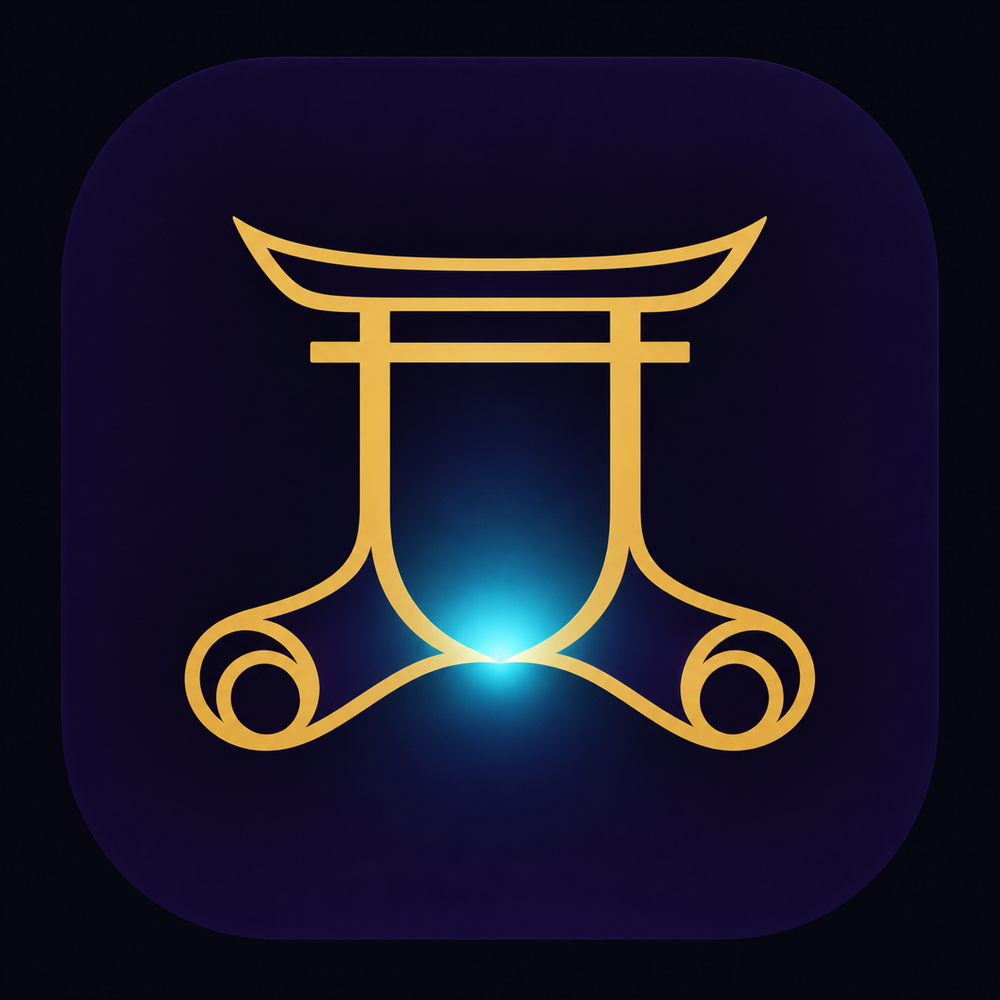

<p align="center">
  
</p>
<h1 align="center">
  Makimono (巻物)
</h1>
<p align="center">
  <b>Cliente de Streaming de Mídia do Google Drive para Android e Android TV</b><br>
  Reprodução de alta performance direto da nuvem com suporte nativo a estilos de legendas fansub (ASS/SSA), controle por D-pad em telas de TV de 3 metros, isolamento por perfis e integração com MediaSession.
</p>

<p align="center">
  Desenvolvido com <a href="https://developers.google.com/drive/api">Google Drive API</a>, <a href="https://developer.android.com/media/media3">AndroidX Media3</a> e <a href="docs/architecture/native-mpv.md">libmpv</a>.
</p>

<div align="center">
  <a href="https://github.com/takaokensei/makimono/releases">
    
  </a>
  <a href="https://github.com/takaokensei/makimono/blob/main/LICENSE">
    
  </a>
</div>

<br>

---

## 📋 Requisitos de Ambiente

- **JDK:** OpenJDK 17 ou superior (`JAVA_HOME` configurado)
- **Android SDK:** `compileSdk 34`, `targetSdk 33`, `minSdk 21`
- **Build Tools:** Android SDK Build-Tools 34.0.0
- **Dispositivo:** Android 5.0+ (Lollipop, API 21+) para celular/tablet ou Android TV 11+ (1080p / 4K UHD)

---

## 🛠️ Como Compilar do Zero

1. **Clonar o repositório:**
   ```bash
   git clone https://github.com/takaokensei/makimono.git
   cd makimono
   ```

2. **Configurar propriedades locais:**
   Copie o modelo de propriedades para criar o seu `local.properties`:
   ```bash
   cp local.properties.example local.properties
   ```
   Defina o caminho do Android SDK (`sdk.dir`) e as credenciais necessárias conforme descrito no arquivo de exemplo.

   > [!NOTE]
   > **Ambiente Windows:** Para evitar falhas de carregamento de classes de teste no Gradle decorrentes de caminhos com caracteres não-ASCII (ex: `C:\Users\Nome Com Acento\...`), execute o build e testes a partir de um caminho estritamente ASCII ou monte uma unidade virtual temporária (ex: `subst T: .` e acesse a partir de `T:\`).

3. **Compilar o APK de desenvolvimento:**
   ```bash
   ./gradlew assembleDebug
   ```
   O binário gerado estará em `app/build/outputs/apk/debug/app-debug.apk`.

---

## 🧪 Como Rodar os Testes e o Lint

Execute as tarefas de validação e verificação de integridade:

```bash
# Executar todos os testes unitários
./gradlew testDebugUnitTest

# Executar verificação de qualidade de código (Lint com baseline ativa)
./gradlew lintDebug

# Executar verificação completa em um único comando
./gradlew testDebugUnitTest lintDebug assembleDebug
```

### Métricas de Integridade do Código (v1.7.1)

- **Testes Unitários:** 570 anotações `@Test` no código-fonte gerando **578 execuções** registradas no relatório JUnit XML (0 falhas, 0 erros). A contagem superior (+8 execuções) decorre da herança de testes de contrato: `BasePlayerEngineContractTest` define 8 métodos de teste executados para os motores Media3 e MPV. Verificação: `python tools/checks/count_tests.py`.
- **Android Lint (Baseline):** 739 issues catalogadas em `app/lint-baseline.xml` com **0 erros bloqueantes** e paridade completa de internacionalização (`MissingTranslation`: 0). Principais categorias: `HardcodedText` (286), `UnusedResources` (178), `SetTextI18n` (102), `InconsistentLayout` (18), `UnusedAttribute` (15). Verificação: `python tools/checks/count_lint_categories.py`.
- **Ferramentas de Verificação Contínua (`tools/checks/`):**
  - `check_strings.py`: Validação de paridade estrita de strings (393 tags `<string>` no total em `values/strings.xml`, sendo 390 traduzíveis validadas contra `values-pt/strings.xml` e 3 não-traduzíveis técnicas marcadas com `translatable="false"`).
  - `check_contrast.py`: Validação de conformidade WCAG AAA/AA para todas as paletas de cores.
  - `check_layout_colors.py` & `check_typography.py`: Auditoria de uso de tokens semânticos e tipografia.
  - `check_no_direct_log.py`: Guarda contra chamadas diretas a `android.util.Log` fora de `AppLog.kt`.
  - `check_readme_claims.py`: Validação contínua de paridade entre as afirmações do README e os valores reais do código.
  - `count_tests.py` & `count_lint_categories.py`: Auditoria automatizada de testes e baseline do Lint.

-----

## 🏛️ Arquitetura

O projeto adota uma arquitetura em camadas focada em separação de preocupações e local-first:

- **`domain`:** Modelos, regras de negócio puras (sem dependências de framework Android).
- **`data`:** Repositórios, cliente Google Drive, Room local e cache de metadados.
- **`playback`:** Motores de reprodução desacoplados sob contrato único (`PlayerEngine`), gerenciando Media3 e MPV nativo.
- **`platform`:** Integrações de plataforma Android TV (`MediaSession`, Watch Next).
- **`ui`:** Apresentação para Android TV (D-pad 10-foot experience, rail de 80dp) e mobile.

Para detalhes completos e decisões de design:
- [Documento Canônico de Arquitetura](docs/architecture/ARCHITECTURE.md)
- [Decisões Arquiteturais (ADRs)](docs/architecture/adr/)
- [Guia do MPV Nativo](docs/architecture/native-mpv.md)

---

## 📚 Documentação do Projeto

- **Design System & TV UX:** [Design System Obsidian](docs/design/DESIGN.md) e [Referências HIG](docs/design/hig-references.md)
- **Garantia de Qualidade:** [Matriz de Dispositivos](docs/qa/device-matrix.md), [Checklist de Foco TV](docs/qa/focus-checklist.md) e [Baseline Diagnóstica](docs/qa/baseline-0.md)
- **Histórico e Releases:** [Diretrizes de Release](docs/releases/README.md) e [Changelog Completo](CHANGELOG.md)

---

## 📜 Licença

Distribuído sob a licença Apache 2.0. Consulte [LICENSE](LICENSE) para mais informações.
