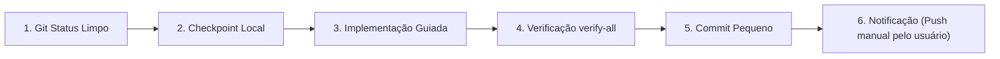

# 🛠️ Fluxo de Trabalho com Agentes — Makimono

Guia de processos, ciclo de vida de desenvolvimento, padrões de verificação e templates de comunicação para agentes de IA (Antigravity e Codex) no Makimono.

---

## 1. Ciclo de Trabalho Linear na `main`

Para manter a simplicidade e a estabilidade contínua, o repositório opera em fluxo estritamente linear direto na branch `main`:



### Regras do Ciclo:
1. **Working Tree Limpo Obrigatório:** Antes de iniciar qualquer tarefa, confirme que `git status` está 100% limpo. Se houver arquivos modificados ou untracked de tarefas anteriores, pare e alinhe com o usuário.
2. **Checkpoint Local:** Em tarefas complexas ou antes de alterar múltiplos componentes, crie um commit de checkpoint ou tag temporária (`git tag checkpoint-nome-da-tarefa`).
3. **Escopo Estrito e Aditivo:** Nunca altere código fora do escopo do briefing. Toda alteração deve ser prioritariamente aditiva.
4. **Verificação Verde Antes do Commit:** Nenhum commit pode ser gerado se `./scripts/verify-all.ps1` (ou `.sh`) falhar.
5. **Commits Pequenos e Atômicos:** Faça commits pequenos ao fim de cada etapa lógica, com mensagem em Conventional Commits.
6. **Push Proibido para o Agente:** O agente NUNCA executa `git push`. O envio remoto é prerrogativa exclusiva do usuário.
7. **Exclusividade de Agente:** Apenas um agente (Antigravity OU Codex) deve operar no repositório por vez.

---

## 2. Como Desfazer Alterações com Segurança

Se algo quebrar ou divergir dos requisitos, siga esta hierarquia de recuperação:

| Situação | Procedimento Recomendado | Comando |
|---|---|---|
| **Arquivos não commitados** | Descartar modificações no working tree mantendo arquivos novos não rastreados | `git restore <arquivo>` |
| **Commit recente incorreto** | Reverter a alteração gerando um novo commit de cancelamento (preserva histórico) | `git revert <hash-do-commit>` |
| **Limpeza de arquivos não rastreados** | Limpar artefatos efêmeros com confirmação de não deletar mídias importantes | `git clean -nd` (dry-run) e `git clean -fd` |
| **Reset destrutivo** | **ÚLTIMO RECURSO:** Exige autorização explícita prévia do usuário, pois descarta histórico local | `git reset --hard HEAD~1` |

---

## 3. Template de Briefing de Tarefa (Usuário ➔ Agente)

Copie e preencha este modelo ao solicitar novas tarefas para qualquer agente:

```markdown
### 🎯 OBJETIVO
[Descrição clara em 1 a 2 frases do que deve ser alcançado]

### 📋 CONTEXTO
[Explicação técnica do estado atual, links para telas ou documentações relevantes]

### 🚫 ESCOPO PERMITIDO & PROIBIÇÕES
- Permitido: [Listar pacotes ou classes que podem ser alterados]
- Proibido: Não alterar [outras telas, bibliotecas, gradle, segredos, etc.]
- Não remover features existentes nem testes existentes.

### 📁 ARQUIVOS TOCÁVEIS
- `app/src/main/java/zechs/drive/stream/...`
- `app/src/main/res/layout/...`
- `app/src/test/java/zechs/drive/stream/...`

### ✅ CRITÉRIOS DE ACEITE
1. [Critério 1 - Ex: O título da franquia deve exibir a raiz canônica]
2. [Critério 2 - Ex: O anel de foco deve se mover suavemente pelo D-pad]
3. [Critério 3 - Ex: Nova classe de política com 100% de cobertura de testes unitários]

### 🧪 COMANDO DE VERIFICAÇÃO
- `powershell -File scripts/verify-all.ps1 -Quick`
```

---

## 4. Template de Prompt de Cross-Review (Revisão Cruzada entre Agentes)

Copie e cole este prompt no agente revisor (ex: Antigravity revisando Codex, ou vice-versa) antes de autorizar o commit:

```markdown
Por favor, atue como Revisor Crítico Sênior de Código e UX para o Makimono (Android TV).
Revise as alterações locais (`git diff`) antes do commit e verifique:

1. 🚨 **Regressões e Inviolabilidade:**
   - Alguma feature, função, saída ou comportamento existente foi apagado ou enfraquecido?
   - Algum teste unitário foi removido, comentado ou afrouxado?
2. 🎨 **Conformidade com DESIGN.md e MOTION.md:**
   - Todos os layouts usam tokens Obsidian (`@color/obsidian_*`) sem hexadecimais brutos?
   - O piso de 12sp foi respeitado?
   - O contraste de texto sobre imagem respeita as diretrizes de scrim direcional (sem overlay uniforme escuro)?
   - Margens seguras de TV (48dp lateral, 27dp vertical) foram mantidas?
3. 📺 **Navegação e Foco D-Pad (10-Foot Experience):**
   - Há garantia de foco único visível na tela?
   - Há confusão entre 'selecionado' e 'focado'?
   - A memória de foco e restauração foi preservada?
4. 🧹 **Higiene e Ciclo de Vida Android:**
   - Há risco de memory leak em ViewBinding (limpeza no `onDestroyView`)?
   - Uso indevido de `android.util.Log` em vez de `AppLog`?
   - Todas as animações chamam `cancel()` antes de redefinir visibilidade?

Aponte qualquer não conformidade com número de linha e justificativa técnica objetiva.
```

---

## 5. Template de Relatório Final do Implementador

Todo agente deve finalizar sua resposta reportando o progresso neste formato:

```markdown
### 📦 Resumo da Entrega
[Breve resumo técnico das ações executadas]

### 📂 Arquivos Criados ou Modificados
- `caminho/arquivo.kt` — [O que mudou e por quê]
- `caminho/arquivo.xml` — [O que mudou e por quê]

### 🧪 Testes & Cobertura
- **Testes novos adicionados:** [Quantidade e classes testadas]
- **Testes existentes:** [Status de execução, ex: todos os 145/592 passaram]

### 🔍 Resultado da Verificação Automática
- `scripts/verify-all.ps1`: ✅ Aprovado (Testes: OK, Lint: OK, Assemble: OK, Checks Estáticos: OK)

### 💡 Decisões Técnicas e Trade-offs
- [Explicação de qualquer decisão de arquitetura ou adaptação do design]

### ⚠️ Ações Manuais do Usuário / Pendências
- [Configurações fora do Git, variáveis de ambiente, push, etc.]

### 🔖 Commit Realizado
- `hash` — `tipo(escopo): mensagem`
```
